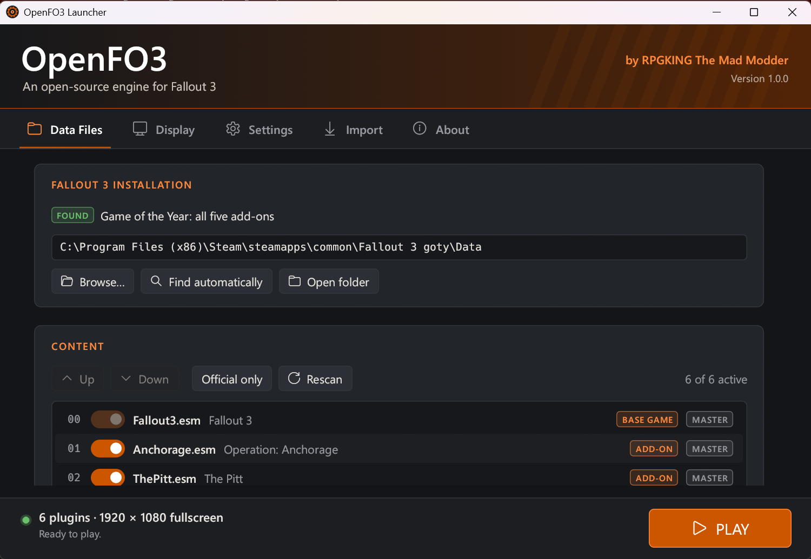
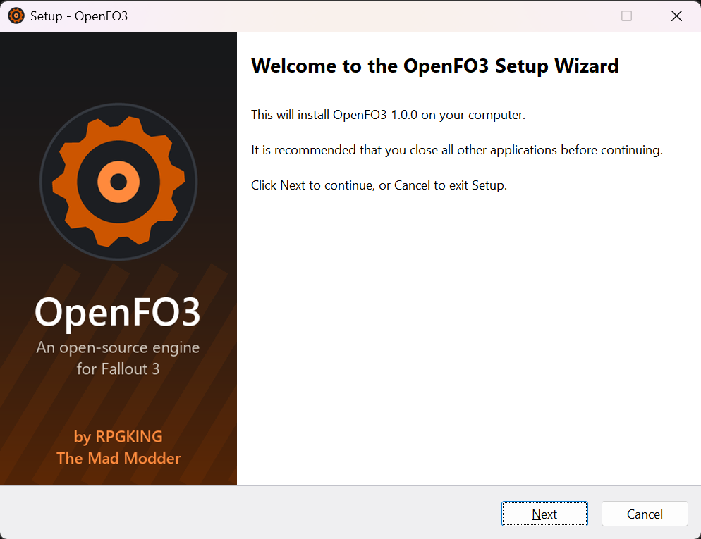
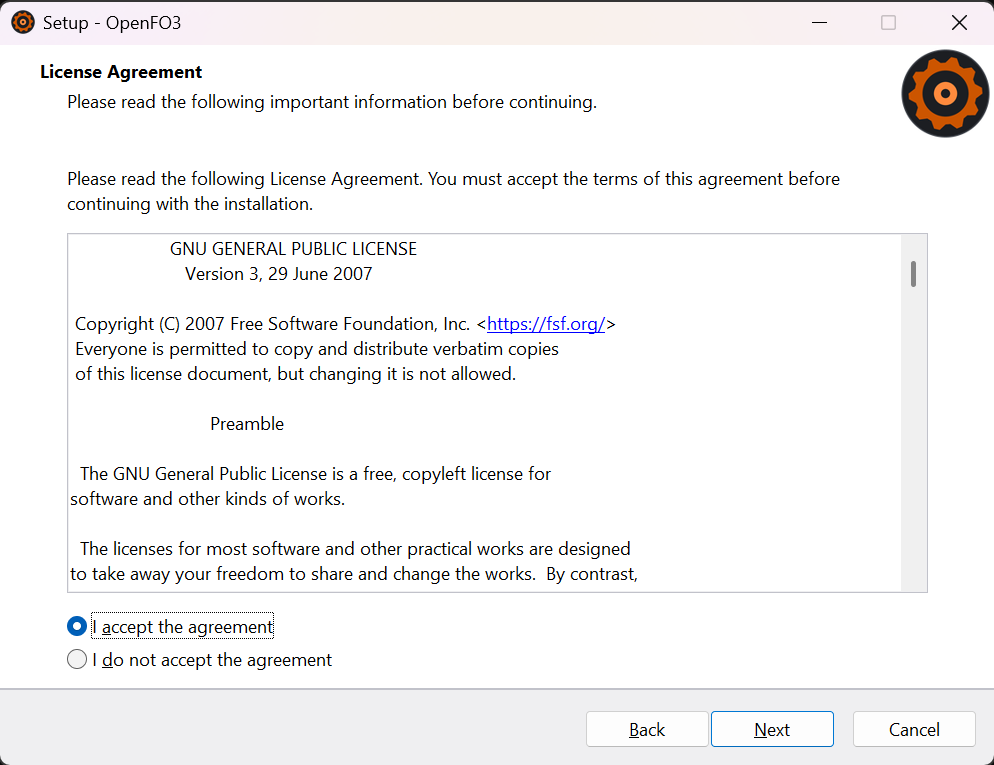

<p align="center">
  
</p>

<h1 align="center">OpenFO3</h1>

<p align="center">Open-source Fallout 3 engine<br>
by RPGKING The Mad Modder</p>

<p align="center">
  
  <a href="LICENSE"></a>
  
  
</p>

OpenFO3 is a new engine for Fallout 3, written in Rust. It runs the game from your own copy. No game files are included.

Not affiliated with Bethesda, ZeniMax or Microsoft. See [LEGAL.md](LEGAL.md).

<p align="center">
  
</p>

## Status

This is version 1.0 and it isn't finished. Bugs will be common, including crashes and stuck quests.

Working:

- Vault 101, from birth to leaving the vault
- Megaton
- The start of Following in His Footsteps
- Main menu, character creation, HUD, Pip-Boy, dialogue, terminals, lockpicking, V.A.T.S., saving and loading
- A launcher that finds your game and sets your plugins and display

Not done:

- The rest of the main quest
- Side quests
- Fallout 3's combat AI
- DLC content
- Script extender plugins

Report bugs in [Issues](../../issues). Press F12 in game to save a screenshot and the game state to the `reports` folder.

## Install

1. Install Fallout 3 (Steam, GOG or disc).
2. Download the installer or zip from [Releases](../../releases).
3. Run OpenFO3 and press PLAY.

OpenFO3 doesn't change your Fallout 3 install, settings or saves. Its saves are in `Documents\My Games\OpenFO3\Saves` and its settings are in `%APPDATA%\OpenFO3`.

### Windows and antivirus warnings

The programs aren't code-signed, so Windows SmartScreen or your antivirus may flag them. If SmartScreen stops it, click **More info**, then **Run anyway**. SHA-256 checksums are on the release page, or you can build it yourself.

<p align="center">
  
  
</p>

## Build

Requires Rust (stable, MSVC).

```powershell
# Game (builds as nv-viewer.exe)
cd viewer
cargo build --release
.\target\release\nv-viewer.exe "C:\Program Files (x86)\Steam\steamapps\common\Fallout 3 goty\Data"

# Launcher
cd ..\launcher
cargo build --release

# Tests
cd ..
cargo test --release --workspace
```

Run the game with `--help` to see its options and controls.

See [CONTRIBUTING.md](CONTRIBUTING.md) if you want to help.

## Credits

- **RPGKING The Mad Modder** - OpenFO3
- **[nv-rs](https://github.com/slaterain/nv-rs) contributors** - the Fallout: New Vegas engine OpenFO3 is built on
- **[OpenMW](https://openmw.org/)** - inspiration
- **[Bevy](https://bevyengine.org/)**, **[egui](https://github.com/emilk/egui)** and **[Inno Setup](https://jrsoftware.org/isinfo.php)** - game engine, launcher UI and installer
- Other libraries are listed in [THIRD-PARTY-NOTICES.txt](distribution/THIRD-PARTY-NOTICES.txt)

## License

GPL v3 or later. See [LICENSE](LICENSE). Code from nv-rs before 2026-10-16 is under MIT. See [LEGAL.md](LEGAL.md).

Copyright (C) 2026 RPGKING The Mad Modder and the nv-rs contributors.
